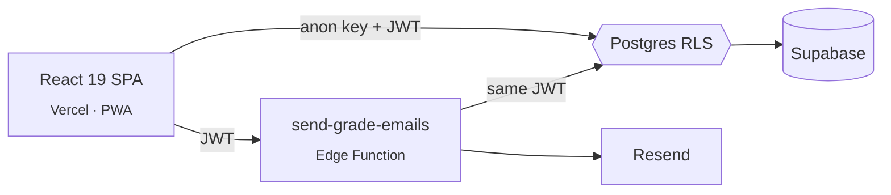

<div align="center">

# Agilearn

**A calm, offline-ready workspace for teachers and school administrators.**

Classrooms · rosters · weighted gradebooks · attendance · posted grades & email · teaching modules

[](https://github.com/azialah/agilearn/actions/workflows/ci.yml)


[Getting started](docs/GETTING_STARTED.md) · [Architecture](docs/ARCHITECTURE.md) · [Database](docs/DATABASE.md) · [All docs](docs/README.md)

</div>

---

## What it does

| For teachers                                                                 | For admins                                  |
| ---------------------------------------------------------------------------- | ------------------------------------------- |
| **Classrooms & subjects** organised by school year and semester              | **Users & roles** — directory, promotion    |
| **Weighted gradebook** — periods → components → categories → activities      | **Domain allowlist** and sign-up requests   |
| **DepEd & CHED** transmutation, grade floors, combined subject finals        | **School overview** analytics               |
| **Attendance** — present / absent / late / excused, works offline            | **Audit log** of role and data changes      |
| **Class-record import** from Excel with auto-mapped, reusable presets        |                                             |
| **Posted grades** imported from a sheet and **emailed** to each student      |                                             |
| **Exports** to `.xlsx` and PDF, a full-screen grade **slideshow**            |                                             |
| **Teaching modules** library, calendar, analytics, low-grade alerts          |                                             |

Installable as a PWA. Attendance and scores entered offline sync automatically,
with conflicts surfaced instead of overwritten.

## How it works



No application server. The browser talks to Supabase directly, and **Row Level
Security in Postgres is the security boundary** — teachers only ever reach their own
classrooms, whatever the UI does. One Edge Function exists solely to hold the email
provider's key. More in [Architecture](docs/ARCHITECTURE.md) and
[Security](docs/SECURITY.md).

## Stack

| Area        | Choice                                                                 |
| ----------- | ---------------------------------------------------------------------- |
| UI          | React 19 · TypeScript 7 (strict) · Vite 8 · TanStack Router            |
| State       | TanStack Query (server) · Zustand (UI) · IndexedDB (offline)           |
| Tables      | TanStack Table + Virtual                                               |
| Styling     | Tailwind CSS 4 (CSS-first `@theme`) · Radix UI · Motion                |
| Backend     | Supabase Postgres, Auth, Storage · one Deno Edge Function              |
| Files       | xlsx (Excel import/export) · pdf-lib                                   |
| Quality     | Vitest · Testing Library · Prettier · Bugsnag                          |
| Delivery    | Vercel (static) · Supabase CLI · GitHub Actions                        |

## Quick start

```bash
pnpm install
supabase start && supabase db reset      # local Postgres + sample data
cp .env.example .env                     # paste the URL + anon key supabase printed
pnpm dev
```

Sign in with a seeded account (password `password123`). Full walkthrough, including
prerequisites and the email function: [Getting started](docs/GETTING_STARTED.md).

## Scripts

| Command                 | Purpose                                 |
| ----------------------- | --------------------------------------- |
| `pnpm dev`              | Dev server with HMR                     |
| `pnpm run test`         | Vitest                                  |
| `pnpm run typecheck`    | `tsc -b --noEmit`                       |
| `pnpm run format`       | Prettier, write                         |
| `pnpm run format:check` | Prettier, check (the CI lint gate)      |
| `pnpm run build`        | Typecheck + production build            |
| `pnpm preview`          | Serve the build (tests the service worker) |

## Project layout

```text
src/
├── routes/          thin file-based routes (routeTree.gen.ts is generated)
├── features/        all UI and logic — teacher/, admin/, auth/, settings/, landing/
├── lib/
│   ├── queries/     every Supabase read/write + keys.ts
│   ├── grading.ts   the only place grade math lives
│   └── …            supabase client, offline queue, utilities
├── components/      ui/ primitives + layout/ shell
└── styles/app.css   Tailwind v4 tokens
supabase/
├── migrations/      0001 … 0040 — the database source of truth
├── functions/       send-grade-emails
└── seed.sql         local-only sample data
docs/                engineering documentation
```

## Documentation

| Guide                                            | Covers                                          |
| ------------------------------------------------ | ----------------------------------------------- |
| [Getting started](docs/GETTING_STARTED.md)       | Local setup and daily workflow                  |
| [Architecture](docs/ARCHITECTURE.md)             | Layers, data flow, auth, feature map            |
| [Database](docs/DATABASE.md)                     | Every table, policy, trigger, view and RPC      |
| [Grading engine](docs/GRADING.md)                | How grades are computed and converted           |
| [Offline & PWA](docs/OFFLINE.md) · [Mobile](docs/MOBILE.md) | Service worker, sync queue, phone UI |
| [Grade emails](docs/EMAIL.md)                    | The Edge Function and its guardrails            |
| [Security](docs/SECURITY.md)                     | Trust boundaries and pre-ship checklist         |
| [Testing](docs/TESTING.md)                       | What's tested and how to add tests              |
| [Deployment](docs/DEPLOYMENT.md)                 | Supabase + Vercel provisioning                  |
| [Troubleshooting](docs/TROUBLESHOOTING.md)       | Known failures and fixes                        |
| [Decisions](docs/DECISIONS.md)                   | Architecture decision records                   |

## Contributing

Read [`CONTRIBUTING.md`](CONTRIBUTING.md). The short version:

- Routes stay thin; features hold the logic.
- Supabase is only called from `src/lib/queries/*`, with keys from `keys.ts`.
- Grades are only computed in `src/lib/grading.ts`.
- Every migration enables RLS and updates `database.types.ts` and `docs/DATABASE.md`.
- No new dependencies.
- Green gate before every PR:

  ```bash
  pnpm run format:check && pnpm run typecheck && pnpm run test && pnpm run build
  ```
