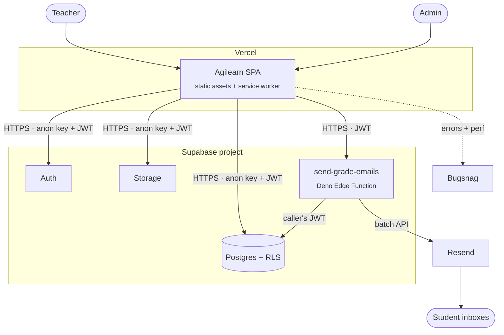
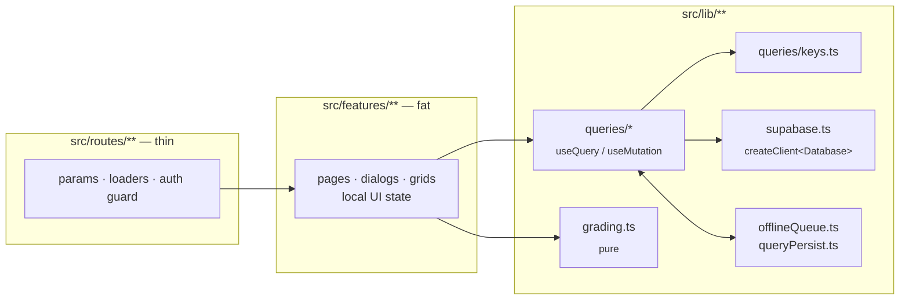
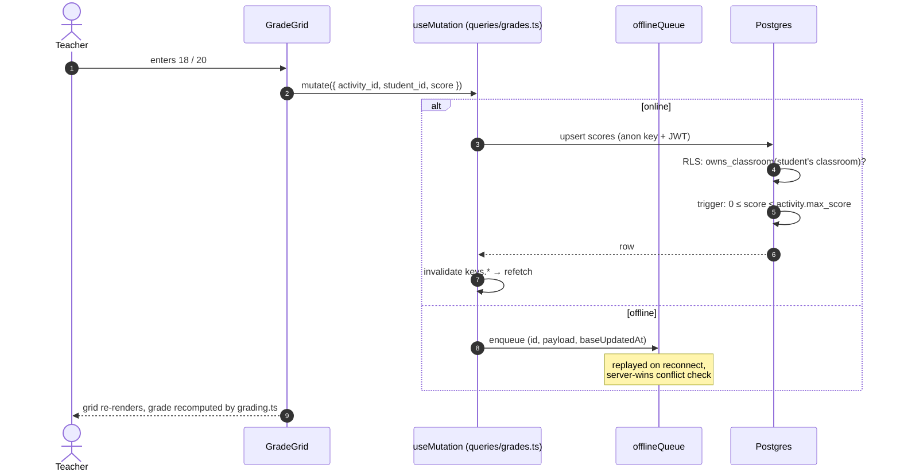
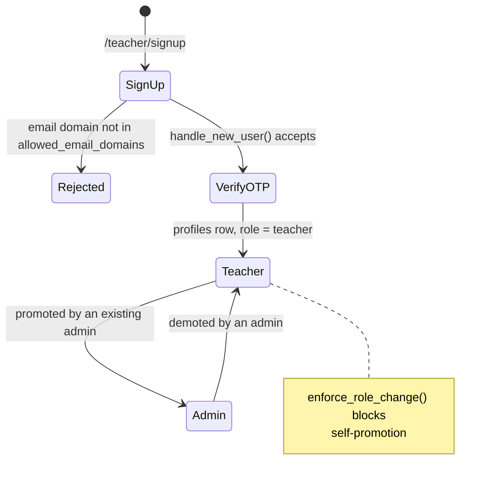
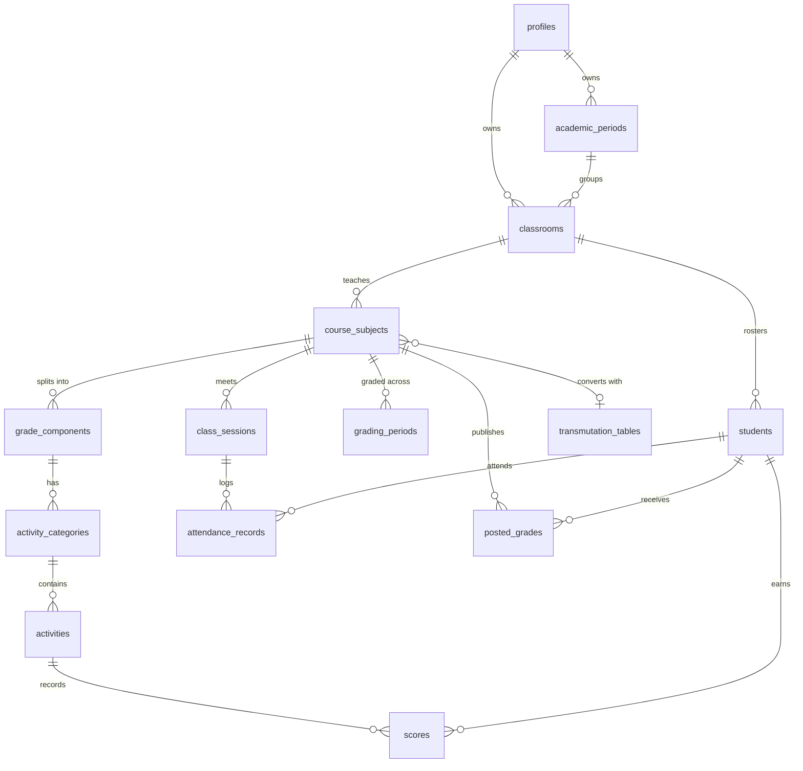
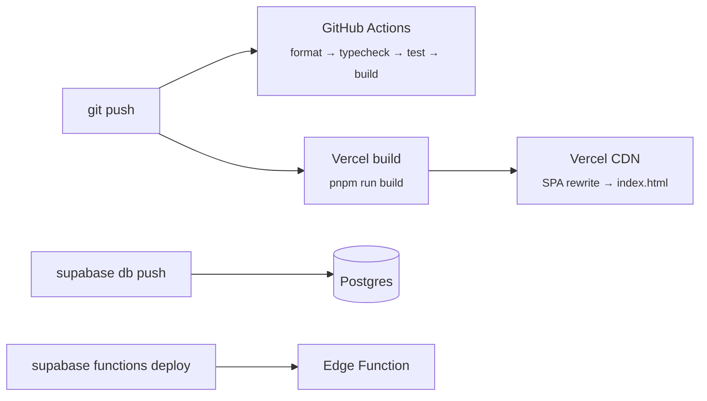

# Architecture

Agilearn is a **static single-page app plus a managed database**. The browser talks
to Supabase directly with the public anon key and the signed-in user's JWT, and
**Postgres Row Level Security decides every read and write**. There is no
application server to deploy, scale or secure.

> [!IMPORTANT]
> If you remember one rule: **the database is the security boundary**. A UI bug
> may show a button it shouldn't — it can never return a row RLS forbids.

---

## System context

| Component              | Runtime          | Holds secrets?                | Deployed by                  |
| ---------------------- | ---------------- | ----------------------------- | ---------------------------- |
| SPA                    | Browser / PWA    | No — anon key is public       | Vercel, on push              |
| Postgres, Auth, Storage | Supabase        | Managed by Supabase           | `supabase db push`           |
| `send-grade-emails`    | Supabase Edge (Deno) | `RESEND_API_KEY` only     | `supabase functions deploy`  |

There is **no service-role key anywhere** — not in the SPA, not in the function.

---

## Layers inside the SPA

| Layer           | Path                       | Rule                                                                                   |
| --------------- | -------------------------- | -------------------------------------------------------------------------------------- |
| Routes          | `src/routes/**`            | Read params, run guards, render a feature. No data logic. `routeTree.gen.ts` is generated. |
| Features        | `src/features/<area>/`     | All UI and orchestration. Local, ephemeral UI state only.                              |
| Data            | `src/lib/queries/*`        | The **only** code that calls Supabase. Reads are `useQuery`, writes are `useMutation` that invalidate `keys.*`. |
| Query keys      | `src/lib/queries/keys.ts`  | The only source of key tuples, so invalidation can't drift.                            |
| Grade math      | `src/lib/grading.ts`       | Pure, deterministic, no Supabase import. See [GRADING.md](GRADING.md).                 |
| Types           | `src/lib/database.types.ts` → `src/types/domain.ts` | Generated schema types → friendly `Classroom`, `Student`, … aliases. |
| Design system   | `src/components/ui/`, `src/styles/app.css` | Radix primitives + Tailwind v4 tokens under `@theme` (no config file).   |

### State ownership

| State                          | Owner                                  |
| ------------------------------ | -------------------------------------- |
| Anything that came from Supabase | TanStack Query — never copied into component state |
| Auth session and token refresh | The Supabase client (`persistSession`) |
| Writes made while offline      | IndexedDB queue (`offlineQueue.ts`)    |
| Cache snapshot for offline reload | IndexedDB (`queryPersist.ts`)       |
| Transient UI (open dialog, filters) | `useState` / Zustand inside the feature |
| Per-device conveniences (theme, recent classrooms) | `localStorage`       |

---

## A write, end to end

A teacher types a score into the gradebook.

Nothing between step 2 and the database is ours to secure — the database
enforces itself.

---

## Auth and roles

- **Sign-in:** email + password at `/login`; password reset by 6-digit OTP at
  `/forgot-password`.
- **Teacher sign-up:** a six-step wizard at `/teacher/signup`, gated in the
  database by `handle_new_user()` against `allowed_email_domains`. Unknown schools
  can file a domain request, which admins review.
- **Admins** are never self-served. The very first admin is bootstrapped once by
  migration `0035`; every later admin is promoted from the Users page.
- **Session storage** honours "remember me" (localStorage vs sessionStorage),
  except in an installed PWA, which always persists — the OS kills backgrounded
  PWAs and would otherwise sign the user out on every app switch.
- **Route guard:** `src/routes/_auth.tsx` redirects to `/login` without a session.
  This is UX only; RLS is the real gate.

The `_auth/teacher/**` and `_auth/admin/**` folders are organisational. Moving a
route between them changes nothing about who can reach its data.

---

## Feature map

Update this table in the same PR that adds a route or feature.

### Public and auth

| Route                                     | Feature                    | Purpose                                 |
| ----------------------------------------- | -------------------------- | --------------------------------------- |
| `/` · `/features` · `/about`              | `features/landing`         | Marketing site                          |
| `/privacy` · `/terms`                     | `features/public`          | Legal pages                             |
| `/login`                                  | `features/auth`            | Email sign-in                           |
| `/forgot-password`                        | `features/auth`            | OTP password reset                      |
| `/teacher/signup/step-1 … step-6`         | `features/teacher/onboarding` | Domain-gated onboarding wizard       |

### Teacher

| Route                                          | Feature                       | Purpose                                     |
| ---------------------------------------------- | ----------------------------- | ------------------------------------------- |
| `/teacher/dashboard`                           | `teacher/dashboard`           | Today's classes, alerts, quick actions      |
| `/teacher/classrooms`                          | `teacher/classrooms`          | Classroom list + creation wizard            |
| `/teacher/classrooms/$id`                      | `teacher/classrooms`          | Roster, subjects, schedule                  |
| `/teacher/classrooms/$id/grades`               | `teacher/grades`, `teacher/io`, `teacher/posted-grades` | Gradebook grid, import/export, posted grades, emails |
| `/teacher/classrooms/$id/attendance`           | `teacher/attendance`          | Session list                                |
| `/teacher/classrooms/$id/attendance/$sessionId` | `teacher/attendance`         | Mark present / absent / late / excused      |
| `/teacher/classrooms/$id/slideshow`            | `teacher/slideshow`           | Full-screen grade presentation              |
| `/teacher/modules`                             | `teacher/modules`             | Private teaching-modules library            |
| `/teacher/analytics`                           | `teacher/analytics`           | Grade distribution, at-risk students        |
| `/teacher/calendar`                            | `teacher/calendar`            | Meetings, events, holidays                  |
| `/teacher/usage`                               | `teacher/usage`               | Storage quota meter                         |
| `/teacher/profile`                             | `teacher/profile`             | Public profile + avatar                     |

### Admin and settings

| Route                      | Feature              | Purpose                               |
| -------------------------- | -------------------- | ------------------------------------- |
| `/admin/overview`          | `features/admin`     | School-wide numbers                   |
| `/admin/users`             | `features/admin`     | Directory, roles                      |
| `/admin/domain-requests`   | `features/admin`     | Allowlist + incoming requests         |
| `/admin/audit-log`         | `features/admin`     | Role and data change history          |
| `/settings/*`              | `features/settings`  | Profile, workspace, privacy, about    |

### Non-route modules

| Module                      | Purpose                                                       |
| --------------------------- | ------------------------------------------------------------- |
| `teacher/io`                | Excel class-record import (auto-mapped, saved presets), `.xlsx` and PDF export |
| `teacher/posted-grades`     | Import finished term grades, send them by email               |
| `teacher/notifications`     | Low-average and absence-streak alerts                         |
| `components/layout`         | App shell, dock, command palette, breadcrumbs                 |

---

## Data model in one picture

30 tables, 3 `security_invoker` views, RLS on every table. The full catalogue —
every policy, trigger and RPC — is in [DATABASE.md](DATABASE.md).

---

## Storage

| Bucket             | Visibility | Layout                     | Rule                                                   |
| ------------------ | ---------- | -------------------------- | ------------------------------------------------------ |
| `teaching-modules` | private    | `<owner-uuid>/<file>`      | Owner or admin only; 500 MB per teacher, enforced in a storage policy |
| `avatars`          | public     | `<owner-uuid>/<file>`      | Anyone reads; owner writes own folder                  |

Quota operations: [STORAGE_QUOTA_ADMIN_HANDOFF.md](STORAGE_QUOTA_ADMIN_HANDOFF.md).

---

## Build and delivery

Frontend and backend ship **independently**. A migration is never bundled into a
frontend deploy, so apply schema changes before merging code that depends on them.
Walkthrough: [DEPLOYMENT.md](DEPLOYMENT.md).

---

## Related

- [Decision records](DECISIONS.md) — why it is shaped like this
- [Security model](SECURITY.md) — what protects what
- [Offline & PWA](OFFLINE.md) — the IndexedDB queue in detail
