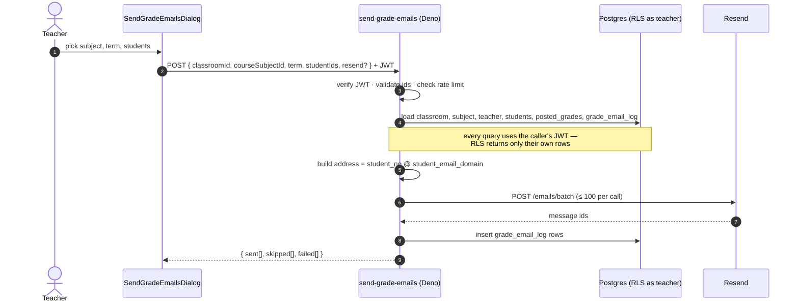

# Grade emails

Teachers can email each student their posted grades for one subject and term. Mail
is sent by the **`send-grade-emails`** Supabase Edge Function through Resend, from
`grades.no-reply@agilearn.net`, with `reply_to` set to the teacher.

It is the only server-side code in Agilearn, and it exists for one reason: the
Resend API key cannot ship to a browser.

---

## Flow



## The request carries ids only

Every address, grade, CC/BCC and the teacher's name is read from the database, so
a tampered request can't redirect mail or change its content.

| Field             | Type       | Notes                                      |
| ----------------- | ---------- | ------------------------------------------ |
| `classroomId`     | uuid       | must be owned by the caller (RLS)          |
| `courseSubjectId` | uuid       | must belong to that classroom              |
| `term`            | string     | e.g. `Midterm`                             |
| `studentIds`      | uuid[]     | at most 200                                |
| `resend`          | boolean    | send again to students already emailed     |

Response:

```json
{
  "sent":    [{ "studentId": "…", "recipient": "202110190@school.edu.ph" }],
  "skipped": [{ "studentId": "…", "reason": "Already sent" }],
  "failed":  [{ "studentId": "…", "error": "…" }]
}
```

Skip reasons: `Not in this classroom`, `No <term> grade posted`,
`No usable SchoolID`, `Already sent`.

---

## Guardrails

| Guard                       | How                                                                     |
| --------------------------- | ----------------------------------------------------------------------- |
| Authenticated caller        | `verify_jwt = true` in `supabase/config.toml`                           |
| No privileged access        | Client is built from the caller's JWT + anon key; **no service-role key** |
| Only the teacher's school   | Student domain and every CC/BCC must match the domain of the caller's verified email (or a subdomain), plus any `GRADE_EMAIL_EXTRA_DOMAINS` |
| Volume                      | ≤ 200 recipients per request, ≤ 400 emails per teacher per hour (counted from `grade_email_log`) |
| No accidental double sends  | Students already in `grade_email_log` for that subject + term are skipped unless `resend: true` |
| Bounded CC/BCC              | ≤ 3 each, enforced by a check constraint on `classrooms`                |

> [!NOTE]
> `grade_email_log` is the teacher's own send history and quota counter, not a
> tamper-proof audit trail — owners can insert into it.

---

## Data it uses (migration `0040`)

| Column / table                                | Purpose                                   |
| --------------------------------------------- | ----------------------------------------- |
| `classrooms.student_email_domain`             | Appended to `students.student_no` to form the address |
| `classrooms.grade_email_cc` / `_bcc`          | Copied on every email                     |
| `posted_grades`                               | Lecture, Laboratory, term grade per student + subject + term |
| `grade_email_log`                             | One row per attempt, `sent` or `failed`, with the Resend id |

---

## Configuration

| Secret / env                 | Where                                        | Required |
| ---------------------------- | -------------------------------------------- | -------- |
| `RESEND_API_KEY`             | `supabase secrets set` (hosted) · `supabase/functions/.env` (local) | yes |
| `GRADE_EMAIL_EXTRA_DOMAINS`  | same                                         | no — comma-separated extra allowed domains |

> [!CAUTION]
> Never prefix these with `VITE_` and never reference them from `src/`. Anything
> `VITE_*` ends up in the public bundle.

### Local

```bash
cp supabase/functions/.env.example supabase/functions/.env   # Resend *test* key
supabase functions serve send-grade-emails --env-file supabase/functions/.env
```

### Hosted

```bash
supabase secrets set RESEND_API_KEY=re_...
supabase functions deploy send-grade-emails
```

The sending domain (`agilearn.net`) must be verified in Resend with its SPF and
DKIM records. Full steps in [DEPLOYMENT.md](DEPLOYMENT.md#7b-grade-emails-resend--edge-function).

---

## Files

| File                                                  | Role                         |
| ----------------------------------------------------- | ---------------------------- |
| `supabase/functions/send-grade-emails/index.ts`       | Handler, validation, sending |
| `supabase/functions/send-grade-emails/template.ts`    | Subject, HTML and text body  |
| `src/lib/queries/postedGrades.ts`                     | `supabase.functions.invoke` mutation |
| `src/features/teacher/posted-grades/`                 | Import dialog, send dialog   |

Adding a second Edge Function needs the same justification — a secret that cannot
live in the browser. See [DECISIONS.md](DECISIONS.md#adr-002-one-edge-function-only-when-a-secret-demands-it).
