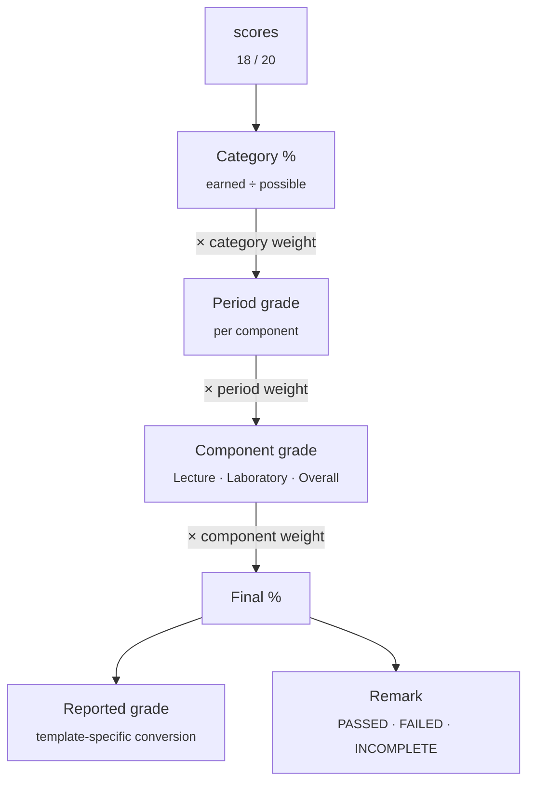

# Grading engine

Every grade Agilearn shows, exports, presents or emails is computed by one pure
module: [`src/lib/grading.ts`](../src/lib/grading.ts). It imports nothing from
Supabase, has no side effects, and is covered by five test files.

> [!IMPORTANT]
> **Never compute a grade anywhere else** — not in a component, not in SQL, not in
> the Edge Function. If a screen needs a new number, add a function here with a test.

---

## The model

| Level        | Table                 | Weighted by                     |
| ------------ | --------------------- | ------------------------------- |
| Subject      | `course_subjects`     | —                               |
| Component    | `grade_components`    | component weight (e.g. Lec 40 / Lab 60) |
| Period       | `grading_periods`     | period weight (e.g. Midterm 50 / Finals 50) |
| Category     | `activity_categories` | category weight (e.g. Quizzes 30) |
| Activity     | `activities`          | points (`max_score`)            |
| Score        | `scores`              | —                               |

Weights are decimals (`0.4` = 40%).

### Rules that matter

1. **Renormalisation.** A category or period with no graded work for a student
   drops out, and the remaining weights are rescaled to sum to 1. A structure whose
   weights don't total 100% still grades; `findWeightIssues()` reports the gap so
   the UI can warn instead of blanking the gradebook.
2. **Full precision until the end.** Rounding (`round2`) happens once, on output.
3. **`null` means "no grade yet"** and propagates upward — it is never coerced to 0.
4. **The one hard gate:** `computeCombinedFinalGrade()` refuses to renormalise a
   missing Lecture subject into 100% Laboratory. `save_subject_grade_combination()`
   enforces the same rule in SQL.

---

## Scoring policy (per subject)

Set on `course_subjects` (migration `0036`) and passed in as `structure.policy`.

| Option           | Default | Effect                                                                 |
| ---------------- | ------- | ---------------------------------------------------------------------- |
| `floor`          | `0`     | Compresses each category % into `[floor, 100]`: `floor + p × (100 − floor) / 100`. `60` gives the Philippine college convention `raw/max × 40 + 60`. |
| `ungradedAsZero` | `false` | A blank score counts as 0 instead of dropping out — spreadsheet behaviour. |

Absent policy = historical behaviour, so older subjects are untouched.

---

## Grading templates

`computeReportedFinalGrade(structure, scores, studentId, config)` is the single
entry point every screen uses. The template decides the conversion order:

| Template                          | Conversion                                                                 |
| --------------------------------- | -------------------------------------------------------------------------- |
| `basic_education`, `senior_high`  | **Transmute each period** through the table, then combine. The combination is not re-transmuted (DepEd convention). |
| `higher_education`                | **Combine first**, then convert the single final %: via the subject's table, or `bandChedGrade()` on the 1.00–5.00 scale. |
| `custom` / none                   | Raw weighted percentage.                                                   |

### Transmutation tables

Reference data in `transmutation_tables` + `transmutation_bands`, readable by all,
writable by admins. Seeded:

- **DepEd Order 8, s. 2015** (default) — 39 bands. A best-effort reproduction;
  verify against the current DepEd issuance before it feeds a real report card.
- **CHED numeric equivalent (1.00–5.00)** — display-only, with a deliberate gap at
  80.50–88.49% where source data was missing. Scores there resolve to `null`.

### CHED formula fallback

`bandChedGrade(percent, increment = 0.25)`: below 75% → `5.00`; otherwise linear
from 75% → `3.00` to 100% → `1.00`, snapped to the increment.

> [!WARNING]
> CHED grades run **backwards** (1.00 is best). Pass/fail is always judged on the
> **percentage** — `remarkFor()` never compares a converted grade.

---

## Remarks and class statistics

| Function            | Returns                                                            |
| ------------------- | ------------------------------------------------------------------ |
| `remarkFor(pct, complete, passing = 75)` | `INCOMPLETE` if not every activity is scored, else `PASSED`/`FAILED` |
| `isConfiguredGradeComplete()` | whether every activity has a score                       |
| `summarizeClass(remarks)` | counts of passed / failed / incomplete                       |

`INCOMPLETE` is derived, not stored.

---

## Posted grades (imported, not computed)

`posted_grades` holds finished Lecture / Laboratory / term grades imported from a
teacher's own sheet. They are displayed and emailed as-is and **never feed
`scores` or the engine**. Two helpers support them:

- `midtermFromComponents(lec, lab)` — fills a blank term grade as
  `lec × 0.40 + lab × 0.60`.
- `postedGradeMismatch(lec, lab, term)` — flags a sheet whose term grade disagrees
  with that formula (≥ 1 point for whole numbers, > 0.01 for decimals).

---

## API cheat sheet

| Need                                  | Call                                    |
| ------------------------------------- | --------------------------------------- |
| One student's reported final          | `computeReportedFinalGrade`             |
| Per-period / per-component breakdown  | `computeConfiguredStudentGradebook`     |
| One row of the period grade sheet     | `computePeriodSheetRow`                 |
| DepEd quarterly grades                | `computeTransmutedStudentGradebook`     |
| Blend several subjects                | `computeCombinedFinalGrade` / `computeCombinedPeriodGrade` |
| Warn about weights                    | `findWeightIssues`, `hasExactWeightTotal` |
| Convert a percentage                  | `transmuteGrade`, `bandChedGrade`       |

---

## Changing the engine

1. Write the failing test first, in the matching file:

   | File                                  | Covers                                 |
   | ------------------------------------- | -------------------------------------- |
   | `grading.test.ts`                     | core roll-up, renormalisation, nulls   |
   | `grading.policy.test.ts`              | floor, ungraded-as-zero                |
   | `grading.transmutation.test.ts`       | DepEd tables                           |
   | `grading.ched.test.ts`                | CHED scale                             |
   | `grading.classrecord.test.ts`         | parity with real paper class records   |

2. Keep the function pure — inputs in, number out.
3. Run `pnpm exec vitest src/lib/grading` and the full gate.
4. Update this page.
