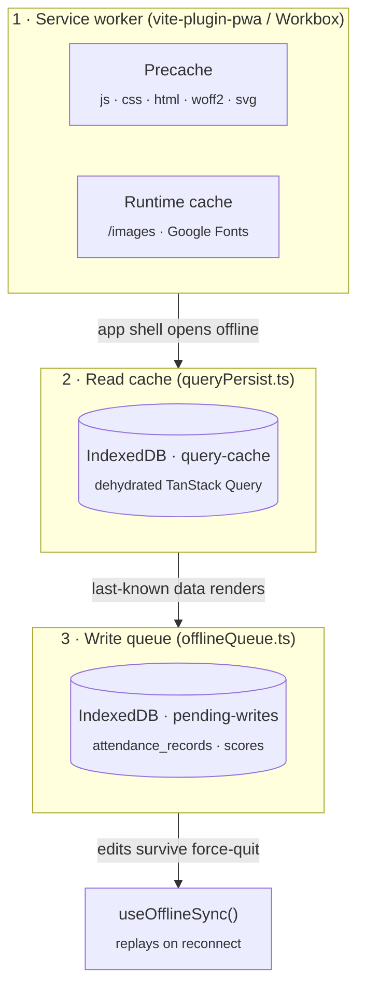
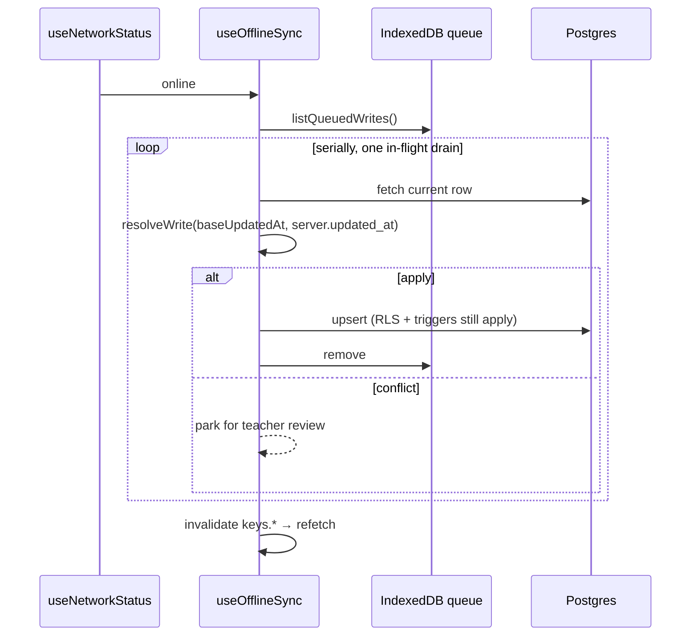

# Offline & PWA

Teachers take attendance in rooms with bad signal. Agilearn is built so a lost
connection costs **nothing**: the app still opens, still shows the last data, and
still accepts attendance and score edits, which replay when the connection returns.

UI conventions for phones and the installed app are in [MOBILE.md](MOBILE.md).

---

## Three layers



| Layer          | File                         | Survives            | Holds                         |
| -------------- | ---------------------------- | ------------------- | ----------------------------- |
| App shell      | `vite.config.ts` → Workbox   | Until next deploy   | Built assets, fonts, icons    |
| Read cache     | `src/lib/queryPersist.ts`    | 7 days, per user    | Successful query results      |
| Write queue    | `src/lib/offlineQueue.ts`    | Until synced or resolved | Pending upserts          |

All IndexedDB data lives in one database, `agilearn-offline`, and is **cleared on
sign-out**.

---

## 1. App shell

- `registerType: 'autoUpdate'` — a new deploy activates on the next load.
- Navigation falls back to `/index.html`, except `/auth*` and Supabase URLs.
- **PNGs are not precached** on purpose (the dashboard illustration alone is
  2.4 MB). `/images/*` is cache-first at runtime after first view.
- The service worker only runs in a production build — use `pnpm build && pnpm preview`
  to test it.

## 2. Read cache

`persistQueryCache(client, userId)` writes a dehydrated snapshot (debounced 1 s)
and hydrates it on boot.

Deliberately **not** persisted:

- the auth session — the Supabase client owns token storage;
- queries in an error or loading state;
- snapshots older than 7 days or belonging to another user.

## 3. Write queue

Only two tables queue offline: `attendance_records` and `scores`. Each write is:

```ts
interface QueuedWrite {
  id: string                 // stable per logical row → retry upserts, never duplicates
  table: 'attendance_records' | 'scores'
  payload: Record<string, unknown>
  onConflict: string         // e.g. 'session_id,student_id'
  baseUpdatedAt: string | null  // the row's updated_at when edited
  queuedAt: number
  label: string              // human-readable, for the review list
}
```

### Sync and conflicts



**Server wins by default.** If the row changed on the server after the edit was
queued, the write is parked — never silently overwritten or dropped. The
`OfflineSyncBar` shows "yours vs theirs" so the teacher decides.

Drains are serial and single-flight because `online` fires repeatedly on a flapping
connection.

---

## Adding a new offline-capable write

1. Add the table to `QueueTable` in `offlineQueue.ts`.
2. Make sure the table has an `updated_at` column maintained by a trigger — the
   conflict check depends on it.
3. In the mutation, enqueue when offline with a **stable** `id` and the correct
   `onConflict` columns.
4. Add a case to `offlineQueue.test.ts`.

> [!CAUTION]
> Never queue a write that isn't idempotent as an upsert. Inserts that create new
> ids on every retry will duplicate rows.

---

## Testing offline by hand

1. `pnpm build && pnpm preview`
2. Load the app once online and open a classroom.
3. DevTools → Network → **Offline**. Reload — the app should render from cache.
4. Mark attendance, then force-close the tab.
5. Reopen, go back online — the edits should sync and the toast should confirm it.
