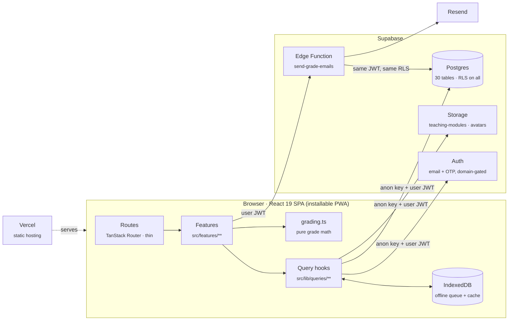

# Agilearn Docs

[](https://github.com/azialah/agilearn/actions/workflows/ci.yml)


Engineering documentation for **Agilearn** — a school-management workspace for
teachers and administrators: classrooms, rosters, weighted gradebooks, attendance,
posted grades with email delivery, and a private teaching-modules library.

> [!NOTE]
> **The 30-second version.** A Vite + React 19 SPA talks straight to Supabase with
> the public anon key. **Postgres Row Level Security is the security boundary** —
> there is no application server. The single exception is one Deno Edge Function,
> `send-grade-emails`, which exists only because Resend needs a server-held key.

**Last updated:** November 18, 2026 · Schema at migration `0040`

---

## Start here

| I want to…                                     | Read                                         |
| ---------------------------------------------- | -------------------------------------------- |
| Run the app locally in 5 minutes               | [Getting started](GETTING_STARTED.md)        |
| Understand how the whole system fits together  | [Architecture](ARCHITECTURE.md)              |
| Add a table, policy, trigger or migration      | [Database](DATABASE.md)                      |
| Change how grades are calculated               | [Grading engine](GRADING.md)                 |
| Work on offline mode, sync or the PWA          | [Offline & PWA](OFFLINE.md) · [Mobile](MOBILE.md) |
| Touch grade emails or the Edge Function        | [Grade emails](EMAIL.md)                     |
| Review something for security                  | [Security model](SECURITY.md)                |
| Write or run tests                             | [Testing](TESTING.md)                        |
| Provision Supabase and deploy to Vercel        | [Deployment](DEPLOYMENT.md)                  |
| Fix a broken build, login or migration         | [Troubleshooting](TROUBLESHOOTING.md)        |
| Know _why_ something is built the way it is    | [Decision records](DECISIONS.md)             |
| Follow the rules for a pull request            | [`CONTRIBUTING.md`](../CONTRIBUTING.md)      |

---

## System at a glance



| Layer             | Owns                                                         | Never does                                         |
| ----------------- | ------------------------------------------------------------ | -------------------------------------------------- |
| **Browser**       | UI, routing, server-state cache, offline queue, grade math   | Hold a secret, or make an access decision RLS doesn't also make |
| **Postgres**      | Source of truth, RLS, integrity triggers, quotas             | Compute a grade average                            |
| **Edge Function** | Sending mail with a server-held key                          | Use a service-role key, or trust addresses from the request |

---

## Documentation map

```text
docs/
├── README.md                         ← you are here
├── GETTING_STARTED.md                local setup, first run, daily workflow
├── ARCHITECTURE.md                   layers, feature map, data flow, auth
├── DATABASE.md                       every table, policy, trigger, view, RPC
├── GRADING.md                        the grade engine and its templates
├── OFFLINE.md                        PWA, IndexedDB queue, conflict handling
├── MOBILE.md                         phone + installed-PWA UI conventions
├── EMAIL.md                          send-grade-emails Edge Function
├── SECURITY.md                       threat model and review checklist
├── TESTING.md                        what is tested, how to add tests
├── DEPLOYMENT.md                     Supabase + Vercel provisioning
├── TROUBLESHOOTING.md                known failure modes and fixes
├── DECISIONS.md                      architecture decision records
├── STORAGE_QUOTA_ADMIN_HANDOFF.md    500 MB/teacher quota operations
├── BACKLOG.md                        roadmap with acceptance criteria
├── EMAIL_DELIVERY_ROADMAP.md         original email design (superseded by EMAIL.md)
└── audits/                           dated audits · TEMPLATE.md for new ones
```

Dated development logs live in [`../dev-updates/`](../dev-updates/).

---

## The quality gate

Every change passes the same four steps CI runs
([`.github/workflows/ci.yml`](../.github/workflows/ci.yml)), in this order:

```bash
pnpm run format:check   # Prettier — the only lint gate (no ESLint)
pnpm run typecheck      # tsc -b --noEmit, strict mode
pnpm run test           # vitest run
pnpm run build          # tsc -b && vite build
```

A green build alone is not enough — formatting drift and type errors fail CI on
their own.

## Keeping these docs honest

Docs drift the same way types do. Update them **in the same PR** as the change:

- New migration → [DATABASE.md](DATABASE.md) table + `src/lib/database.types.ts`
- New route or feature → the feature map in [ARCHITECTURE.md](ARCHITECTURE.md)
- New grade rule → [GRADING.md](GRADING.md) + a test in `src/lib/grading*.test.ts`
- New env var or secret → [GETTING_STARTED.md](GETTING_STARTED.md) + [DEPLOYMENT.md](DEPLOYMENT.md)
- New architectural trade-off → a record in [DECISIONS.md](DECISIONS.md)
