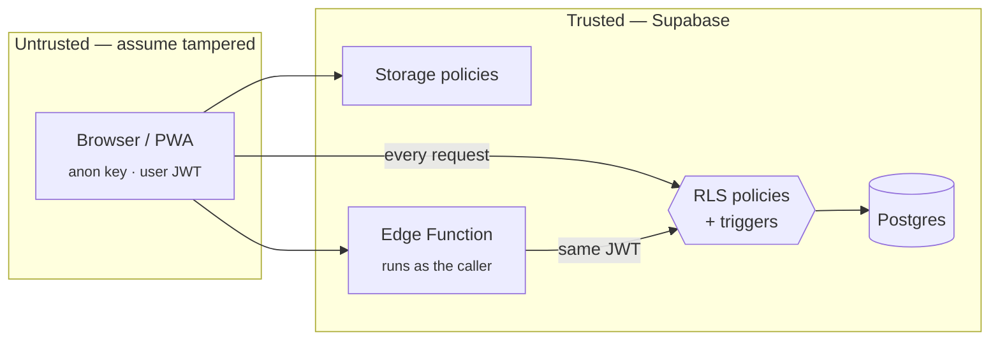

# Security model

Agilearn's whole security story fits in one sentence: **the browser is untrusted,
and Postgres enforces every rule with Row Level Security.** This page lists what
protects what, and the checklist to run before shipping anything sensitive.

---

## Trust boundaries

| Asset                     | Protected by                                                     |
| ------------------------- | ---------------------------------------------------------------- |
| A teacher's classrooms, roster, grades, attendance | `owns_classroom(cid)` in every policy      |
| Admin-only data           | `is_admin()` (`SECURITY DEFINER`, no recursion)                  |
| Role escalation           | `enforce_role_change()` trigger                                  |
| Who can sign up           | `handle_new_user()` against `allowed_email_domains`              |
| Score integrity           | `enforce_score_within_activity_max()`, `prevent_activity_max_below_existing_scores()` |
| Cross-classroom references | Composite FKs `(id, classroom_id)` — FK checks ignore RLS, so these stop pointing at another teacher's rows |
| Teaching-module files     | Private bucket, owner-folder policies, 500 MB quota with advisory lock |
| Grade email reach         | Domain match on the caller's verified email, rate limits         |
| Audit trail               | `audit_log` written only by `SECURITY DEFINER` triggers          |

---

## Secrets inventory

| Value                    | Where it lives                            | Public? |
| ------------------------ | ----------------------------------------- | ------- |
| `VITE_SUPABASE_URL`      | `.env`, Vercel env, browser bundle        | yes     |
| `VITE_SUPABASE_ANON_KEY` | `.env`, Vercel env, browser bundle        | yes — safe because RLS is the gate |
| `VITE_BUGSNAG_API_KEY`   | `.env`, Vercel env, browser bundle        | yes     |
| `RESEND_API_KEY`         | Supabase function secrets only            | **no**  |
| Database password        | Supabase dashboard / your password manager | **no** |
| Service-role key         | **Not used anywhere.** Its appearance in the repo is a critical leak. | — |

---

## Rules

- **No service-role key**, anywhere — not in `src/`, not in the Edge Function.
- **Every new table**: `ENABLE ROW LEVEL SECURITY` plus at least one policy, in the
  same migration. A table without a policy is a critical gap.
- **Policies use the helpers** — `is_admin()` and `owns_classroom()`. Never query
  `profiles` from a policy on `profiles` (infinite recursion), never reference
  `auth.users` in a policy.
- **Views are `security_invoker = true`.** Without it a view runs as its owner and
  leaks every classroom.
- **Subject- or student-scoped child tables** get a composite FK to
  `(id, classroom_id)` so they cannot point across classrooms.
- **Private stays private.** `teaching-modules` is never made public and never
  gets long-lived public URLs.
- **The client never sets timestamps or owner ids** — triggers derive them.
- **Never hand-manage the auth session** — the Supabase client owns it.
- **No secrets in git.** `.env` and `supabase/functions/.env` are gitignored.
- **Redirects after login** go through `safeRedirect.ts` to block open redirects.

---

## Pre-ship checklist

Run before merging anything that touches migrations, auth, storage or env.

**Database**

- [ ] Every new table has RLS enabled and a policy using the helpers
- [ ] New views set `security_invoker = true`
- [ ] Child tables with `classroom_id` use the composite FK pattern
- [ ] `SECURITY DEFINER` functions set `search_path` explicitly
- [ ] Destructive migrations have a pre-flight query in `supabase/checks/`

**Client**

- [ ] `grep -rn "service_role" src supabase/functions` returns nothing
- [ ] No new `VITE_*` variable holds a secret
- [ ] No grade math or authorization decision exists only in the UI

**Isolation test** (against a local stack with the seed)

- [ ] Teacher A sees zero rows of Teacher B's classrooms, students, scores
- [ ] `update profiles set role = 'admin' where id = auth.uid()` fails as a teacher
- [ ] Teacher A cannot read or write Teacher B's `teaching-modules` folder
- [ ] An admin can read every profile and classroom

---

## Known, accepted trade-offs

| Trade-off                                               | Why it's acceptable                       |
| ------------------------------------------------------- | ----------------------------------------- |
| `allowed_email_domains` is readable by anyone           | Lets the sign-up form pre-validate; domains aren't secret |
| `avatars` bucket is public                              | Profile pictures only                     |
| `grade_email_log` is insertable by owners               | It is a quota counter and history, not an audit log |
| DepEd / CHED tables are best-effort reproductions       | Flagged in-migration; verify before official use |

## Reporting a vulnerability

Do not open a public issue. Contact the maintainers privately with steps to
reproduce, and allow time for a fix before disclosure.
